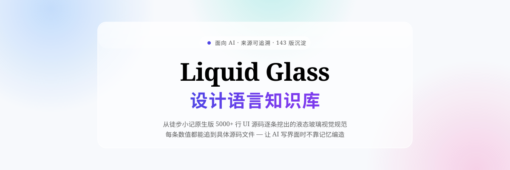

**面向 AI 的 Liquid Glass 设计语言知识库 · 徒步小记原生版实战沉淀**

---

这是一份个人整理的知识库，记录「徒步小记」Android 原生版（Kotlin + Jetpack Compose）在 **143 版迭代**中沉淀出的整套 Liquid 玻璃设计语言。不是 Google 官方规范，也不是 Material Design 的替代品——是一套在真机上被反复验证、每条结论都能追到具体源码文件的实战规范。

在线预览（落地页）：**https://niukingdom.github.io/Liquid-Design-Knowledge/**

## 这个库解决什么问题

让 AI（或人）在写这套视觉风格的界面时**不靠记忆编造**：

- 圆角用几档？字号有没有半号？——有固定档位表，不现拍数字。
- 玻璃该用真折射还是自绘？——按场景分四种实现，有明确选择口诀。
- 换个颜色为什么要改两个地方？——强调色随主题变，文字只有黑白。
- 出现方块残影怎么办？——六个真凶按出现顺序排查，没有一次是靠删玻璃解决的。

**每条数值型结论都标注了来源文件和核验方式。** 本库不把"看起来像"写成"规范如此"。

---

## 六条不可协商的原则

每一条都对应一次真实的返工。不是审美偏好，是拿"方块、闪退、不像一套东西"换出来的。

| # | 原则 | 要点 |
|---|---|---|
| 1 | **玻璃是地基，不许削弱换稳定** | 出问题改附加物（离屏层、阴影、裁剪、缩放链），绝不降低玻璃效果本身。用户原话："我的折射呢？？？？" |
| 2 | **文字只有黑白** | 主文字纯黑/纯白，层次靠 `62%` / `40%` 透明度与字重。彩色只给背景、色带、图标，不给正文 |
| 3 | **尺寸只有档位** | 圆角 6 档、字号 9 档、弹窗 3 档。新增组件只取值，不许现拍数字 |
| 4 | **按钮全平面，液态集中在浮层** | 普通按钮一张薄面 + 一条细边；液态质感只在底栏胶囊、顶栏、弹窗三处 |
| 5 | **会动的自己画** | 会移动的玻璃走纯 Canvas 自绘、零离屏层；静止大浮层才用真 backdrop；一堆小按钮走平面 |
| 6 | **性能是生存项** | 先算同屏层数再决定实现。同屏 10 个 shader 会崩——层数 × 重绘频率才是崩溃根源 |

完整推导见 [`01-Foundations/design-principles.md`](01-Foundations/design-principles.md)。

## 档位速查

所有数值集中定义，新增组件只从这里取。机器可读版在 [`05-Design-Tokens/`](05-Design-Tokens/) 的四个 JSON 里。

| 类别 | 档位值 | 用途 |
|---|---|---|
| 圆角 (6) | `20 / 16 / 12 / 10 / 6 / 4` | 卡片 · 子卡 · 按钮 · 输入框 · 徽章 · 细条 |
| 字号 (9) | `22 / 19 / 16 / 15 / 14 / 13 / 12 / 11 / 10` | 分享卡 · 标题 · 弹窗 · 正文 · 脚注（无半号） |
| 弹窗 (3) | `0.80 / 0.88 / 0.92` | 确认 · 详情 · 表单，限高统一 `0.80` |
| 强调色 | `#4F46E5` → `#A5B4FC` | 浅色 → 深色，随主题切换 |
| 玻璃参数 | `refract 10` · `frost 0.62` | 折射高度 · 白雾浓度（薄雾不白板） |

## 视觉分层

层级不靠阴影 dp，靠玻璃材质与三层 backdrop 的关系。浮层必须是内容层的兄弟节点，不是子节点。

| 层 | 内容 | 关键点 |
|---|---|---|
| 01 背景层 | Aurora 三光斑 | 蓝 / 粉 / 青，周期 `4.4 / 4.8 / 3.6` 秒互质——只动合成层，零重绘 |
| 02 内容层 | 卡片与列表 | 采样 `bgBackdrop`（纯背景），不采样内容——避免递归 |
| 03 浮层 | 顶栏 / 底栏 / 弹窗 | 顶栏真模糊 + 羽化，底栏自绘玻璃 + 胶囊，弹窗真折射 + 二次导出 backdrop |
| 04 反馈层 | Toast / 按压 / 震动 | Toast 用 Popup 保证盖在弹窗之上；点击异常统一兜底不杀进程 |

## 四种玻璃实现

不是重复代码，是成本分层。选错实现就是崩溃和方块的开始。

| 实现 | 机制 | 用在哪 |
|---|---|---|
| `liquidGlassSurface` | 真 backdrop + lens 折射 + blur + 高光 | 弹窗、静止大浮层 |
| `glassBar` / `glassPill` | 纯 Canvas 自绘、零离屏；胶囊用 `clipPath` | 底栏玻璃条、选中胶囊 |
| `liquidGlassChip` | 平面自绘，一层面 + 一条 1dp 细边 | 所有按钮、小件 |
| `glassPanel` | 白 `0.05` 底 + 白 `0.11` 边 + 20dp 圆角 | 卡片、分组容器 |

选择口诀：**会动的自己画，静止的才折射，一堆小的走平面。**

> **最高铁律：液态玻璃不许瞎改，也不许删掉。** 这条是拿四轮返工换来的。修 bug 的正确顺序永远是：保住玻璃本身 → 查附加物 → 只改那个出问题的附加物。任何"把折射删了换稳定"的方案都是错的。

---

## 快速开始

1. 把 [`AI-INSTRUCTIONS.md`](AI-INSTRUCTIONS.md) 设为 AI 项目的指令文件。
2. 从 [`00-Metadata/sources.yaml`](00-Metadata/sources.yaml) 了解一手来源与权威层级。
3. 按下面的「阅读路径」查对应分册，不要跨层猜。
4. 需要改视觉时，先读 [`07-Development-Rules/`](07-Development-Rules/) 的三份规则，再动手。
5. 更新时记录来源文件、核验日期和变化摘要（见 [`00-Metadata/change-log.md`](00-Metadata/change-log.md)）。

## 内容状态

| 目录 | 状态 | 说明 |
|---|---|---|
| [`00-Metadata/`](00-Metadata/) | 可用 | 来源索引、术语表、版本追踪、变更记录 |
| [`01-Foundations/`](01-Foundations/) | 可用 | 原则 / 色彩 / 字体 / 形状 / 动效 / 层级 |
| [`02-Glass-Materials/`](02-Glass-Materials/) | 可用 | 三层 backdrop / 四种实现 / 核心参数 / 降级 / 背景流光 |
| [`03-Components/`](03-Components/) | 可用 | 按钮 / 弹窗 / 顶栏 / 底栏 / Toast / 卡片 |
| [`04-Interaction/`](04-Interaction/) | 可用 | 按压 / 底栏形变 / 安全点击 / 震动 |
| [`05-Design-Tokens/`](05-Design-Tokens/) | 可用 | 机器可读令牌：颜色、圆角、字号、玻璃参数（JSON） |
| [`06-Compose-Implementation/`](06-Compose-Implementation/) | 可用 | API 映射、性能红线 |
| [`07-Development-Rules/`](07-Development-Rules/) | 可用 | 铁律、评审清单、视觉 bug 排查手册 |
| [`08-Source-Map/`](08-Source-Map/) | 可用 | 知识点 ↔ 源码文件映射表，双向可追 |

## 阅读路径

| 你要做的事 | 先看 |
|---|---|
| 做一个新界面 | [`design-principles.md`](01-Foundations/design-principles.md) → [`shape-system.md`](01-Foundations/shape-system.md) |
| 定颜色 | [`color-system.md`](01-Foundations/color-system.md) |
| 定字号 / 字体 | [`typography.md`](01-Foundations/typography.md) |
| 做一块玻璃 | [`02-Glass-Materials/README.md`](02-Glass-Materials/README.md) → [`glass-implementations.md`](02-Glass-Materials/glass-implementations.md) |
| 调折射 / 模糊 / 高光 | [`core-parameters.md`](02-Glass-Materials/core-parameters.md) |
| 做底栏胶囊动效 | [`bottom-bar-motion.md`](04-Interaction/bottom-bar-motion.md) |
| 处理深色 / 旧设备兼容 | [`degradation.md`](02-Glass-Materials/degradation.md) |
| 界面掉帧 / 闪退 | [`performance.md`](06-Compose-Implementation/performance.md) |
| 出现方块残影 | [`visual-bug-triage.md`](07-Development-Rules/visual-bug-triage.md) |
| 查某个数值从哪来 | [`08-Source-Map/README.md`](08-Source-Map/README.md) |

## 资料原则

- **一手来源**：徒步小记原生版源码（`app/src/main/java/com/xixi/hiking/nativeapp/`）。所有规范以实际实现为准。
- **对照基准**：Web 版 CSS（`app.css` / `app-modal.css`）。原生版多处标注"1:1 搬 Web"，这是设计意图的原始出处。
- **技术依赖**：Kyant0/backdrop（AGSL 液态玻璃实现）。API 行为以该库文档和源码为准，不猜版本。
- **用户决策**：源码注释里标「用户原话」的，是产品所有者的明确决定，优先级高于通用审美惯例。
- **次级来源**：第三方液态玻璃教程、博客只用于定位思路，不作为数值依据。
- **本库不固化"看起来差不多"的值**：未能从源码或官方文档确认的数值，一律标注「⚠️ 推断」或「待确认」。

## 重要前提

这套语言的核心技术依托 **AGSL RuntimeShader**（Android API 33+ 的真实背景像素折射），这是 Android 专有能力。所以：

- 这不是纯 CSS glassmorphism——那是毛玻璃，不是液态玻璃。液态玻璃要有厚度感、色散、折射暗示、弹性四个特征。
- 低端机 / 旧 API 走四档降级，静态档用近实心厚玻璃兜底，绝不硬上 shader 崩溃。
- iOS 无对应物，所以本库只覆盖 Android 原生 + Web 对照。

本库所有数值型结论都来自源码实读。源码注释里的 ★ 标记是迭代过程中留下的"为什么是这个值"的解释——**这些解释比数值本身更重要**，本库尽量保留。

## 许可

MIT。知识库正文为个人整理，可自由参考；引用其中结论时请标注来源文件。
